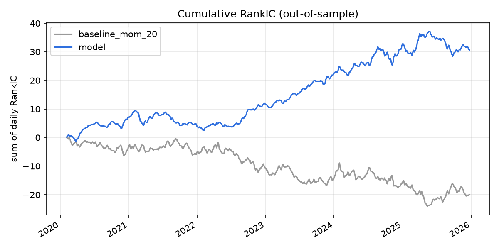
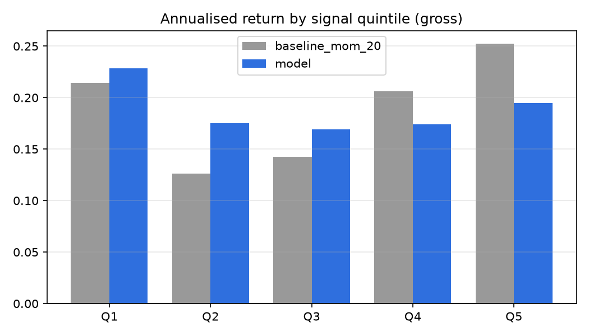
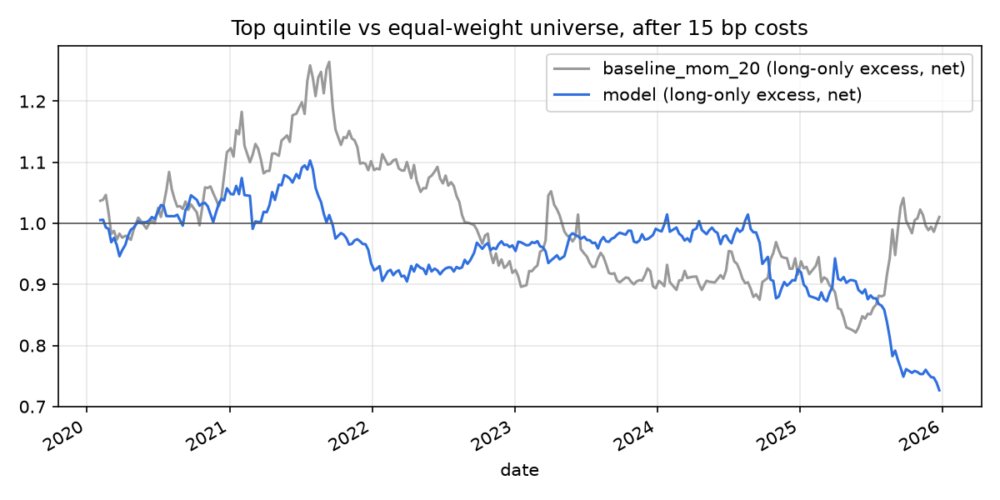

# A-share ML Backtest — cross-sectional return prediction on CSI 300

Every week, rank the CSI 300 stocks by expected 5-day return *relative to each other*, and test
honestly whether a LightGBM model beats a simple momentum rule — first as a ranking (RankIC), then
as a portfolio after trading costs.

**Key finding:** the walk-forward model ranks stocks better than momentum out of sample
(RankIC **0.021** vs **−0.014**, 2020–2025), but the edge does **not** survive as returns.
A-share return skew puts volatile "lottery" stocks — which usually lose but occasionally jump —
in the model's bottom quintile, and weekly rebalancing at 39% turnover costs about **5.8% a year**
against a gross long-only edge of about **0.5% a year**. Positive IC is necessary, not sufficient.
A pre-declared follow-up — monthly rebalancing — cut costs about 3x and turned the net result
slightly positive (+1.6% a year, Sharpe 0.22), but not significantly.

## Results (out-of-sample 2020-02-05 to 2025-12-31, 24 retrains, same dates for every signal)

| Signal | Mean RankIC | ICIR | Hit rate | Long-short Sharpe (gross) | Long-only excess, net of 15 bp | Turnover |
|---|---|---|---|---|---|---|
| Momentum (20-day), baseline | −0.014 | −0.066 | 0.49 | 0.18 | +0.2% / yr | 0.36 |
| **LightGBM, walk-forward** | **0.021** | **0.125** | **0.55** | −0.19 | −5.4% / yr | 0.39 |

Full tables, including Sharpe at 0 / 5 / 15 / 30 bp: [`reports/csi300/results.md`](reports/csi300/results.md).



### Why a positive IC did not make money

Model quintiles on rebalance dates (5-day forward return):

| Quintile | Mean | Median | Std |
|---|---|---|---|
| Q1 (model's worst) | 0.45% | −0.19% | 6.7% |
| Q2 | 0.35% | −0.07% | 5.4% |
| Q3 | 0.33% | −0.10% | 5.3% |
| Q4 | 0.34% | 0.00% | 5.1% |
| Q5 (model's best) | 0.38% | 0.00% | 5.5% |

- **The ranking works in the median** (Q1 −0.19% → Q5 0.00%): most stocks the model dislikes do underperform.
- **Skew cancels it in the mean.** Q1 holds the most volatile, most heavily traded stocks; a few
  large winners lift its average, so a long-short portfolio loses even though most Q1 picks are right.
- **Costs dwarf the tradable edge:** Q5 beats the equal-weight universe by ~0.01% a week (~0.5% a
  year gross), while 2 × 15 bp × 39% turnover × 50 weeks ≈ 5.8% a year.




## Experiment: monthly rebalancing (declared before running; exploratory)

Hypothesis: costs kill the weekly edge, so trading less often should help. One variant only:
20-day label and rebalancing every 20 days; everything else unchanged.

| Model | Mean RankIC | ICIR | Long-short Sharpe (gross) | Long-only excess, net | Net Sharpe | Turnover per rebalance |
|---|---|---|---|---|---|---|
| Weekly (5-day) | 0.021 | 0.125 | −0.19 | −5.4% / yr | −0.59 | 0.39 |
| **Monthly (20-day)** | **0.035** | **0.222** | **0.31** | **+1.6% / yr** | **0.22** | 0.54 |

- **Costs fall about 3x:** 2 × 15 bp × 0.54 × 12.5 rebalances ≈ 2.0% a year, versus ≈ 5.8% weekly.
- **The signal is stronger at 20 days** (RankIC 0.035 vs 0.021): low volatility, low turnover and
  illiquidity are slow-moving effects, so a monthly horizon suits them better.
- The momentum baseline gets worse (RankIC −0.022, net −2.2% a year).
- **Not significant:** about 6 years of monthly periods give a Sharpe standard error of roughly 0.4,
  so a net Sharpe of 0.22 is indistinguishable from zero, and the period was already seen. The
  direction supports the hypothesis; it is not evidence of a tradable strategy.

Full tables: [`reports/csi300_h20/results.md`](reports/csi300_h20/results.md).

## What the factors say about A-shares (full period, exploratory)

| Feature | Mean RankIC | Reading |
|---|---|---|
| 20-day momentum | −0.014 | Momentum is **reversed** at one month — the opposite of the US textbook result |
| 5-day reversal | +0.010 | Short-term reversal works, weakly |
| 20-day volatility | −0.015 | Low-volatility anomaly |
| 20-day turnover | −0.022 | Heavily traded stocks underperform (attention-driven retail trading) |
| Amihud illiquidity | +0.017 | Illiquidity premium; the most consistent factor (ICIR 0.11) |

These full-period ICs are in-sample and were **not** used to choose features or signs; the model
learns each feature's direction from past data only, inside each walk-forward window.

## Method

- **Data:** AkShare, 后复权 (hfq) daily prices for today's 300 CSI 300 members, 2018–2025 (535k rows).
- **Label:** next open → open 5 trading days later. The signal is known only after the close, so
  the first possible trade is the next open; close → close would be a small look-ahead.
- **Features:** 20-day momentum, 5-day reversal, 20-day volatility, 20-day turnover, Amihud
  illiquidity — computed per stock from past data only, then ranked within each date.
  A test perturbs every price after a cut-off and asserts no earlier feature changes.
- **Model:** small, regularised LightGBM (15 leaves, ≥200 samples per leaf, learning rate 0.03,
  subsampling) predicting the per-date rank of the forward return.
- **Walk-forward:** 500-day training window, 60-day test window, retrained 24 times, with a 5-day
  purge gap so no training label overlaps the test period.
- **Evaluation:** RankIC, ICIR, quintile returns, long-short (signal quality) and long-only top
  quintile vs equal-weight universe after costs (tradable — shorting A-shares is restricted),
  turnover, Sharpe, max drawdown. Baseline and model are measured on identical dates.
- **Verification:** a synthetic dataset with planted momentum and reversal; the full pipeline must
  find them (model RankIC 0.057 there). 27 unit tests.

## Limitations

- **Survivorship bias:** only today's index members; stocks removed since 2018 are missing, which
  flatters returns (the sample's average 5-day return of +0.34%, about 18% a year, partly reflects this).
- **Cost assumption:** 15 bp one way (commission, stamp duty, slippage); results at 0–30 bp are reported.
- **Overlapping labels:** daily ICs on 5-day labels are correlated, so naive t-stats overstate
  significance (~4.7 → ~2.1 after adjusting for the overlap).
- **Suspensions:** code works on trading-day rows, so a label can span a long suspension (rare).
- One market, one period, daily data only, equal weights.

## Next steps

1. **Turnover control** — monthly rebalancing helped (above); next, a buffer rule that only sells
   when a stock leaves the top 40%, and validation on a period not yet seen.
2. **LLM sentiment from company announcements (公告)** as an extra feature, with strict
   publication-time alignment.
3. Point-in-time index membership; industry neutralisation; Newey-West t-stats; skew-robust portfolios.

## Run it

```bash
pip install -e ".[dev]"
pytest -q                                            # 27 tests, offline
python -m qml.research --synthetic                   # pipeline check on planted-signal data
python -m qml.data --start 20180101 --end 20251231   # download CSI 300 via AkShare
python -m qml.research                               # real results -> reports/csi300/
```
