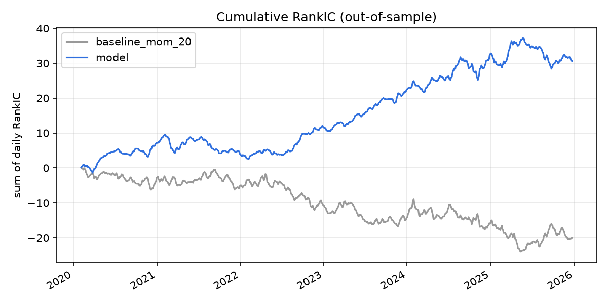
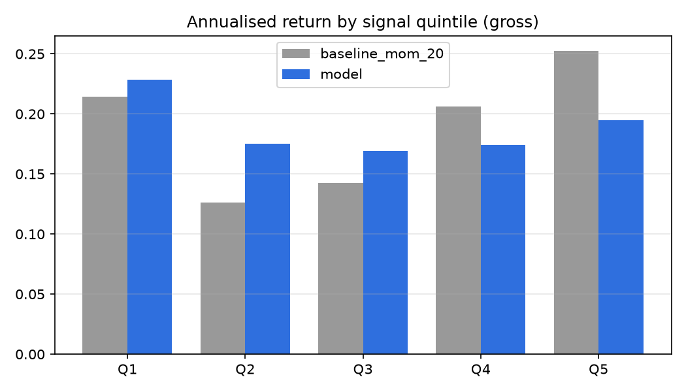
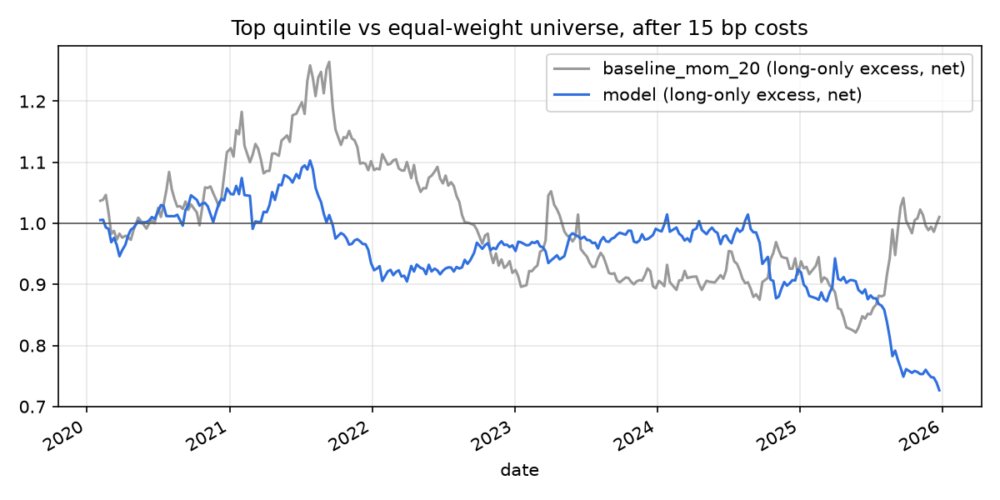

# Results — out-of-sample 2020-02-05 to 2025-12-31

Walk-forward: 24 retrains. Horizon 5 days, rebalanced every 5 days, 5 quantiles. Baseline and model are measured on the same dates.

|                 |   ic_mean |   ic_std |   ic_icir |   ic_t_stat |   ic_hit_rate |   ic_n_dates |   ls_ann_return |   ls_sharpe |   ls_max_dd |   long_excess_ann_net |   long_excess_sharpe_net |   turnover |   long_excess_sharpe_0bp |   long_excess_sharpe_5bp |   long_excess_sharpe_15bp |   long_excess_sharpe_30bp |
|:----------------|----------:|---------:|----------:|------------:|--------------:|-------------:|----------------:|------------:|------------:|----------------------:|-------------------------:|-----------:|-------------------------:|-------------------------:|--------------------------:|--------------------------:|
| baseline_mom_20 |   -0.014  |   0.2108 |   -0.0663 |     -2.5078 |        0.4927 |         1431 |          0.0162 |      0.1813 |     -0.432  |                0.0018 |                   0.0772 |     0.3603 |                   0.5055 |                   0.3628 |                    0.0772 |                   -0.351  |
| model           |    0.0213 |   0.1705 |    0.1251 |      4.7341 |        0.5542 |         1431 |         -0.0483 |     -0.1877 |     -0.4758 |               -0.0541 |                  -0.5907 |     0.3865 |                   0.0742 |                  -0.1471 |                   -0.5907 |                   -1.2573 |

- `ls_*`: top minus bottom quintile, gross (a measure of signal quality; shorting A-shares is restricted).
- `long_excess_*`: top quintile minus the equal-weight universe, after costs (15 bp one way unless named). This is the tradable version.
- `ic_t_stat` ignores the overlap of 5-day labels on consecutive days, so it overstates significance.

