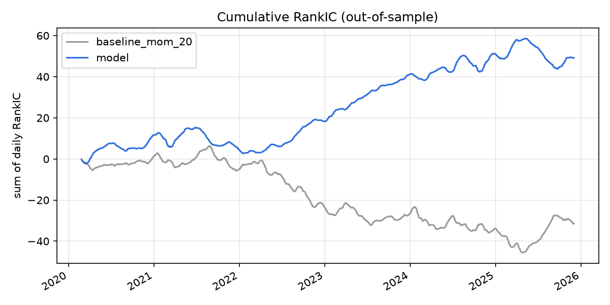
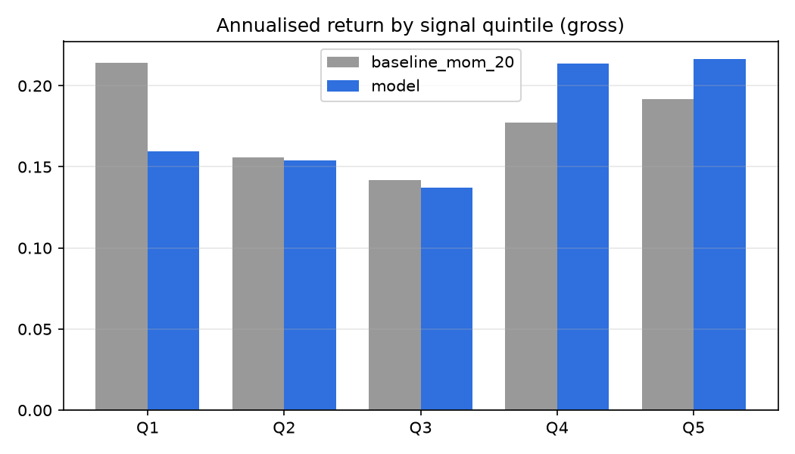
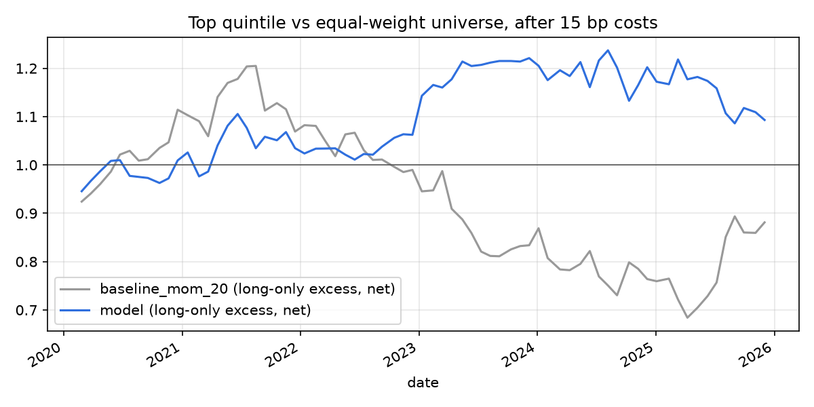

# Results — out-of-sample 2020-02-26 to 2025-12-31

Walk-forward: 24 retrains. Horizon 20 days, rebalanced every 20 days, 5 quantiles. Baseline and model are measured on the same dates.

|                 |   ic_mean |   ic_std |   ic_icir |   ic_t_stat |   ic_hit_rate |   ic_n_dates |   ls_ann_return |   ls_sharpe |   ls_max_dd |   long_excess_ann_net |   long_excess_sharpe_net |   turnover |   long_excess_sharpe_0bp |   long_excess_sharpe_5bp |   long_excess_sharpe_15bp |   long_excess_sharpe_30bp |
|:----------------|----------:|---------:|----------:|------------:|--------------:|-------------:|----------------:|------------:|------------:|----------------------:|-------------------------:|-----------:|-------------------------:|-------------------------:|--------------------------:|--------------------------:|
| baseline_mom_20 |   -0.0224 |   0.195  |   -0.1149 |     -4.3009 |        0.4954 |         1401 |         -0.0506 |     -0.0934 |     -0.6299 |               -0.022  |                  -0.0973 |     0.7614 |                   0.1146 |                   0.0439 |                   -0.0973 |                   -0.309  |
| model           |    0.0351 |   0.1579 |    0.2222 |      8.3187 |        0.606  |         1401 |          0.0403 |      0.305  |     -0.3101 |                0.0158 |                   0.2163 |     0.5424 |                   0.4426 |                   0.367  |                    0.2163 |                   -0.0088 |

- `ls_*`: top minus bottom quintile, gross (a measure of signal quality; shorting A-shares is restricted).
- `long_excess_*`: top quintile minus the equal-weight universe, after costs (15 bp one way unless named). This is the tradable version.
- `ic_t_stat` ignores the overlap of 5-day labels on consecutive days, so it overstates significance.

