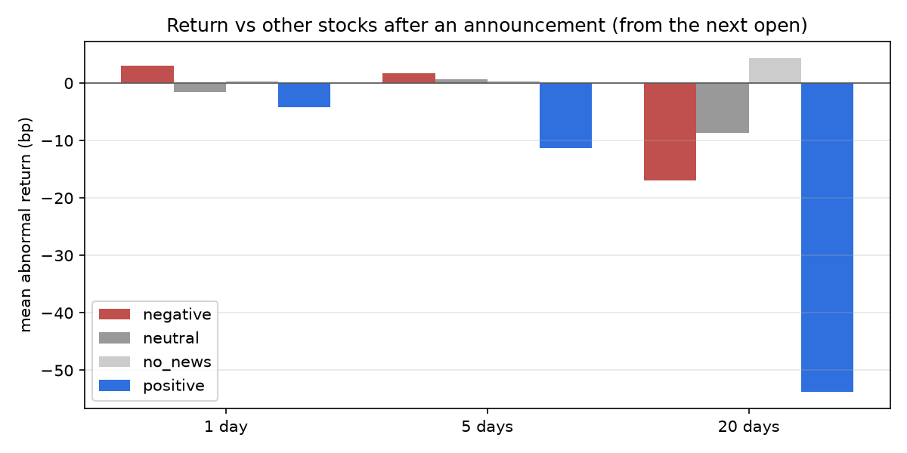

# Event study 20240101–20241231

39,805 announcements (35,882 unique titles), labelled by Kimi for $4.19.
Abnormal return = stock's return minus the equal-weight average of all stocks, from the open
after the announcement's trading day (the first price you could actually trade at).

## Sentiment distribution

|   sentiment |   count |
|------------:|--------:|
|           0 |   34872 |
|           1 |    3564 |
|          -1 |    1369 |

## Abnormal returns by group (mean in %, t-stat, number of stock-days)

| group    |   mean_%_h1 |   mean_%_h5 |   mean_%_h20 |   t_h1 |   t_h5 |   t_h20 |   n_h1 |   n_h5 |   n_h20 |
|:---------|------------:|------------:|-------------:|-------:|-------:|--------:|-------:|-------:|--------:|
| negative |       0.031 |       0.017 |       -0.169 |   0.35 |   0.09 |   -0.47 |    947 |    947 |     947 |
| neutral  |      -0.016 |       0.006 |       -0.087 |  -0.74 |   0.13 |   -0.9  |   9802 |   9802 |    9802 |
| no_news  |       0.004 |       0.004 |        0.044 |   0.49 |   0.21 |    1.06 |  58183 |  58183 |   58183 |
| positive |      -0.042 |      -0.113 |       -0.538 |  -1.01 |  -1.28 |   -2.95 |   2865 |   2865 |    2865 |

## 5-day abnormal return by event type and sentiment

| event         |   sentiment |     n |   mean_% |
|:--------------|------------:|------:|---------:|
| routine       |           0 | 26915 |    0.202 |
| earnings      |           0 |  3352 |    0.284 |
| management    |           0 |  1893 |    0.141 |
| financing     |           0 |  1225 |    0.097 |
| buyback       |           1 |   870 |   -0.25  |
| dividend      |           1 |   675 |    0.5   |
| restructuring |           0 |   626 |   -0.325 |
| contract      |           1 |   553 |   -0.393 |
| management    |           1 |   326 |    0.403 |
| financing     |          -1 |   307 |    0.183 |
| dividend      |           0 |   299 |   -0.071 |
| insider_buy   |           1 |   256 |   -0.479 |
| earnings      |           1 |   235 |   -0.103 |
| routine       |           1 |   227 |    0.201 |
| insider_sell  |          -1 |   204 |    0.646 |
| restructuring |           1 |   203 |   -0.336 |
| earnings      |          -1 |   195 |    0.421 |
| pledge        |           0 |   194 |    0.5   |
| buyback       |           0 |   186 |   -0.168 |
| pledge        |          -1 |   169 |    0.099 |
| penalty       |          -1 |   159 |   -0.56  |
| management    |          -1 |   147 |   -0.193 |
| financing     |           1 |   135 |   -0.357 |
| routine       |          -1 |    81 |    0.861 |
| pledge        |           1 |    63 |   -0.512 |
| buyback       |          -1 |    57 |   -0.794 |
| insider_sell  |           0 |    36 |    1.377 |
| restructuring |          -1 |    31 |   -0.7   |
| contract      |           0 |    19 |    1.529 |
| penalty       |           1 |    11 |   -1.432 |
| dividend      |          -1 |     9 |   -0.122 |
| insider_buy   |           0 |     7 |   -0.791 |
| contract      |          -1 |     5 |   -2.313 |
| penalty       |           0 |     4 |    2.595 |
| insider_sell  |           1 |     4 |   -3.676 |

