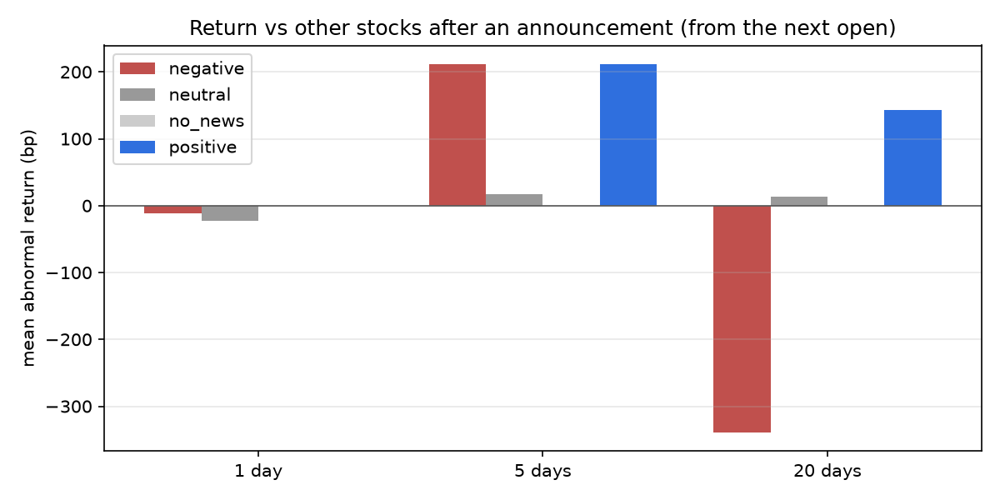

# Event study 20240101–20241231

200 announcements (199 unique titles), labelled by Kimi for $0.02.
Abnormal return = stock's return minus the equal-weight average of all stocks, from the open
after the announcement's trading day (the first price you could actually trade at).

## Sentiment distribution

|   sentiment |   count |
|------------:|--------:|
|           0 |     174 |
|           1 |      22 |
|          -1 |       4 |

## Abnormal returns by group (mean in %, t-stat, number of stock-days)

| group    |   mean_%_h1 |   mean_%_h5 |   mean_%_h20 |   t_h1 |   t_h5 |   t_h20 |   n_h1 |   n_h5 |   n_h20 |
|:---------|------------:|------------:|-------------:|-------:|-------:|--------:|-------:|-------:|--------:|
| negative |      -0.116 |       2.116 |       -3.396 |  -0.13 |   0.91 |   -2.73 |      4 |      4 |       4 |
| neutral  |      -0.232 |       0.171 |        0.129 |  -1.49 |   0.5  |    0.19 |    168 |    168 |     168 |
| no_news  |       0.001 |      -0.001 |       -0.001 |   0.07 |  -0.06 |   -0.01 |  71603 |  71603 |   71603 |
| positive |       0.001 |       2.12  |        1.431 |   0    |   1.23 |    0.37 |     22 |     22 |      22 |

## 5-day abnormal return by event type and sentiment

| event         |   sentiment |   n |   mean_% |
|:--------------|------------:|----:|---------:|
| routine       |           0 | 119 |   -0.046 |
| earnings      |           0 |  19 |    1.549 |
| management    |           0 |  15 |   -0.331 |
| buyback       |           1 |  12 |    4.324 |
| financing     |           0 |   9 |    3.621 |
| contract      |           1 |   3 |   -3.967 |
| dividend      |           1 |   3 |    1.097 |
| buyback       |           0 |   3 |   -0.444 |
| pledge        |           0 |   3 |    0.319 |
| restructuring |           0 |   3 |   -1.44  |
| financing     |          -1 |   2 |    4.617 |
| earnings      |           1 |   2 |    0.666 |
| penalty       |          -1 |   1 |   -4.078 |
| management    |           1 |   1 |   -3.955 |
| insider_sell  |          -1 |   1 |    3.31  |
| routine       |           1 |   1 |    5.987 |

