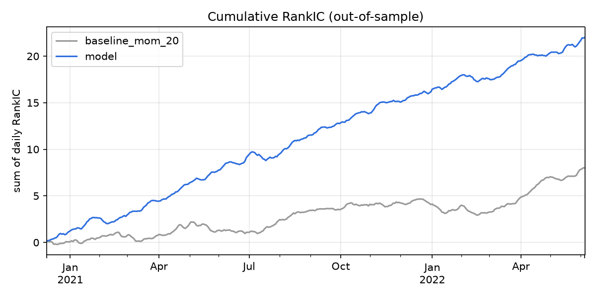
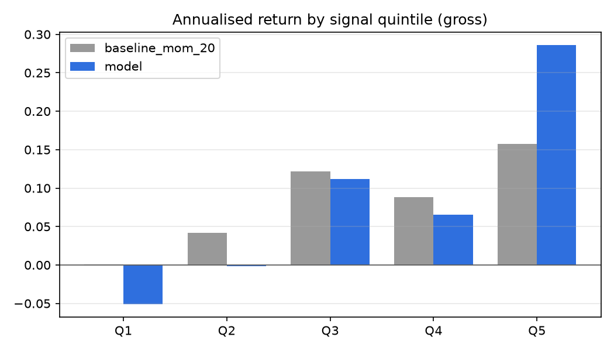
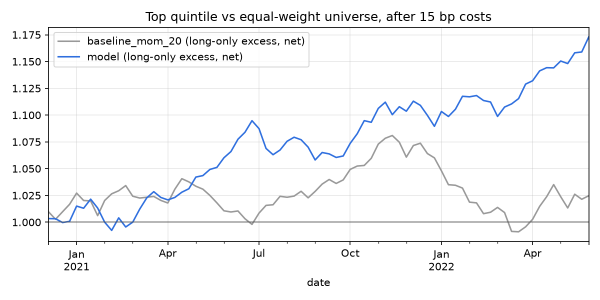

# Results — out-of-sample 2020-12-09 to 2022-06-14

Walk-forward: 7 retrains. Horizon 5 days, rebalanced every 5 days, 5 quantiles. Baseline and model are measured on the same dates.

|                 |   ic_mean |   ic_std |   ic_icir |   ic_t_stat |   ic_hit_rate |   ic_n_dates |   ls_ann_return |   ls_sharpe |   ls_max_dd |   long_excess_ann_net |   long_excess_sharpe_net |   turnover |   long_excess_sharpe_0bp |   long_excess_sharpe_5bp |   long_excess_sharpe_15bp |   long_excess_sharpe_30bp |
|:----------------|----------:|---------:|----------:|------------:|--------------:|-------------:|----------------:|------------:|------------:|----------------------:|-------------------------:|-----------:|-------------------------:|-------------------------:|--------------------------:|--------------------------:|
| baseline_mom_20 |    0.0205 |   0.0931 |    0.22   |      4.3389 |        0.5913 |          389 |          0.1657 |      1.9458 |     -0.0715 |                0.0158 |                   0.3224 |     0.3827 |                   1.4339 |                   1.0633 |                    0.3224 |                   -0.7852 |
| model           |    0.0566 |   0.0923 |    0.6133 |     12.097  |        0.7404 |          389 |          0.3952 |      4.253  |     -0.0432 |                0.1077 |                   2.03   |     0.6661 |                   3.9981 |                   3.3424 |                    2.03   |                    0.0633 |

- `ls_*`: top minus bottom quintile, gross (a measure of signal quality; shorting A-shares is restricted).
- `long_excess_*`: top quintile minus the equal-weight universe, after costs (15 bp one way unless named). This is the tradable version.
- `ic_t_stat` ignores the overlap of 5-day labels on consecutive days, so it overstates significance.

